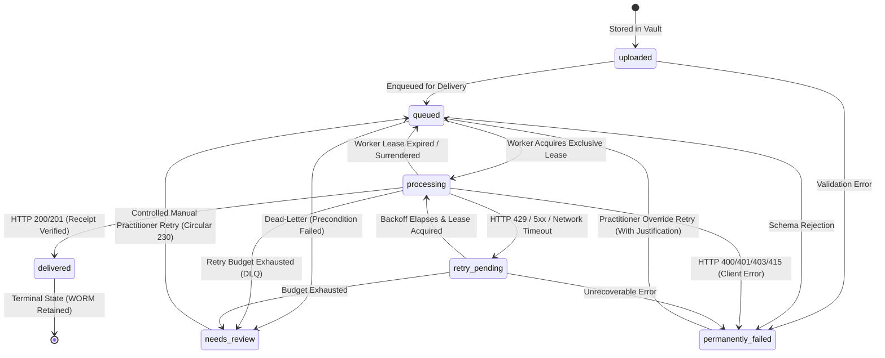

# The File Room: Durable Document Delivery Queue Architecture & Governance Specification

**Authoritative Statutory Standard:** Internal Revenue Code (IRC) § 6061, Treasury Department Circular 230 § 10.22, FTC Safeguards Rule (16 CFR § 314.4), & IRS Publication 1345 § 5.2.2.  
**Classification:** Practice Infrastructure & Document Transmission Governance  
**Authoritative Backend:** Google Cloud Firestore, Google Cloud Functions (v2 / Node.js 20), Google Cloud Storage, Google Cloud Scheduler / Tasks.

---

## 1. Executive Summary & Architectural Invariants

The File Room implements a **durable, transactional, and audit-logged document-delivery queue** to govern the transmission of sensitive tax documents (e.g., W-2s, 1099s, Schedule K-1s, Form 8879s, closing statements) from client upload custody to downstream firm processing gateways (Forminit / Formsphere).

### Core Architectural Invariants:
1. **Firestore is the Single Authoritative Queue & Status Store:** All queue items, execution attempts, retry timers, worker leases, and delivery receipts are authoritatively persisted in the Firestore collection `document_delivery_queue`.
2. **Storage Reference Persisted Prior to Queuing:** A taxpayer document MUST be securely stored in an authorized Cloud Storage bucket (`clients/{clientId}/tax-years/{taxYear}/documents/...`) and its storage reference persisted before downstream delivery can be enqueued.
3. **No Authoritative Client Storage (The Zero Data Loss Fallacy):** `localStorage` and `sessionStorage` are strictly treated as **ephemeral, non-authoritative client crash-recovery aids**. Browser local storage is unencrypted, accessible to client-side scripts, can be wiped at any time by the browser or user, and is NEVER treated as the authoritative copy of a taxpayer document. The system **never claims zero data loss solely because localStorage is enabled**.
4. **Strict Dual-State User Feedback:** The user interface explicitly distinguishes between:
   - **Upload Success (Storage Vault Custody):** Document is verified, scanned, and safely vaulted in Google Cloud Storage with AES-256 encryption.
   - **Downstream Delivery Success (Gateway Transmission):** Document is transmitted to downstream processing endpoints with confirmed receipt verification.
5. **Controlled Manual Recovery under Circular 230 § 10.22:** Items routed to the Dead-Letter Queue (`needs_review`) cannot be re-queued without verified practitioner authorization, a recorded clinical/compliance justification, and an immutable audit ledger entry.

---

## 2. Seven-State Finite State Machine (FSM)

The delivery queue operates under an explicit 7-state finite state machine with strict legal transition rules:



### State Definitions & Legal Transition Table

| State | Classification | Description | Permitted Next States |
| :--- | :--- | :--- | :--- |
| `uploaded` | Initial Vault State | Document uploaded and vaulted in Cloud Storage; reference recorded in Firestore. | `queued`, `permanently_failed` |
| `queued` | Pending Execution | Ready for worker execution; eligible immediately or upon scheduled sweep. | `processing`, `permanently_failed`, `needs_review` |
| `processing` | In-Flight / Leased | Exclusive worker lease acquired via atomic Firestore transaction (60s lease). | `delivered`, `retry_pending`, `permanently_failed`, `needs_review`, `queued` |
| `retry_pending` | Backoff Hold | Transient failure encountered (429, 5xx, timeout); backoff timer active. | `processing`, `queued`, `permanently_failed`, `needs_review` |
| `delivered` | Terminal Success | Downstream receipt verified (200 OK); immutable delivery timestamp and receipt ID. | **None (Terminal Immutable)** |
| `permanently_failed` | Non-Retryable Error | Non-retryable client error (400, 401, 403, 415); halts retries to avoid wasting budget. | `queued` (Controlled practitioner override only) |
| `needs_review` | Dead-Letter Queue | Retry budget exhausted (e.g. 5/5 attempts) or downstream payload hold; practitioner review required. | `queued` (Controlled manual retry), `permanently_failed` |

---

## 3. Mandatory Document Queue Metadata Schema

Every document in `/document_delivery_queue/{jobId}` must capture the following authoritative fields:

```typescript
interface DocumentDeliveryJob {
  // Identification & Idempotency
  jobId: string;                        // Deterministic: ddq_{clientId}_{documentId}_{checksum}
  idempotencyKey: string;               // Stable key sent in X-Idempotency-Key headers
  documentId: string;                   // Reference in /documents collection
  requestId?: string;                   // Reference in /documentRequests collection
  clientId: string;                     // Authenticated taxpayer UID
  clientEmail: string;                  // Taxpayer email
  clientName?: string;                  // Taxpayer display name
  taxYear: number;                      // Statutory tax year (e.g. 2026)
  fileName: string;                     // Sanitized original filename

  // Cloud Storage Vault Reference (Mandatory Prerequisite)
  storagePath: string;                  // Authorized path: clients/{uid}/tax-years/{year}/...
  fileStorageUri: string;               // Bucket URI: gs://uk-client-d90d5.appspot.com/...
  downloadUrl?: string;                 // Signed or authorized media URL
  sha256Checksum: string;               // Cryptographic SHA-256 payload integrity hash
  retentionPolicy: string;              // "IRC § 6061 3-Year Statutory Custody"
  storageReferenceRetained: boolean;    // Must remain true throughout delivery lifecycle

  // State Machine & Retry Telemetry
  status: DeliveryStatus;               // uploaded | queued | processing | delivered | retry_pending | permanently_failed | needs_review
  attemptCount: number;                 // 0-indexed attempt count
  maxAttempts: number;                  // Default 5; incremented only via manual retry
  nextAttemptAt: string | null;         // ISO-8601 timestamp when job becomes eligible
  lastAttemptAt: string | null;         // Timestamp of most recent transmission attempt
  lastErrorCategory: ErrorCategory | null; // RATE_LIMITED_429 | SERVER_ERROR_5XX | NETWORK_TIMEOUT | etc.
  lastErrorMessage: string | null;      // Error description (truncated to 300 chars)
  lastHttpStatus: number | null;        // Downstream HTTP status code

  // Mutual Exclusion Worker Lease
  leaseOwner: string | null;            // Unique worker identifier (e.g. worker_srv_pid_ts)
  leaseExpiresAt: string | null;        // ISO-8601 lease expiration timestamp (now + 60s)

  // Delivery Confirmation
  deliveredAt: string | null;           // ISO-8601 timestamp of verified delivery
  deliveryReceipt?: {                   // Downstream verification payload
    status: number;
    receiptId: string;
    timestamp: string;
  };

  // Timestamps & Audit Trail
  createdAt: string;                    // ISO-8601 creation time
  updatedAt: string;                    // ISO-8601 last update time
  history: Array<{                      // Chronological immutable audit trail
    attempt?: number;
    timestamp: string;
    status: DeliveryStatus;
    action: string;
    workerId?: string;
    statusCode?: number;
    errorCategory?: string;
    errorMessage?: string;
    nextAttemptAt?: string | null;
    staffUid?: string;
    justification?: string;
  }>;
}
```

---

## 4. Retry Policy, Exponential Backoff, & Jitter

### 4.1. Exponential Backoff with Full Jitter
To prevent downstream thundering herd problems, The File Room uses the AWS Architecture **Full Jitter** algorithm:

$$\text{sleep} = \text{rand}(0, \min(T_{\max}, T_{\text{base}} \times 2^{\text{attempt} - 1}))$$

- **Base Backoff ($T_{\text{base}}$):** 5 seconds
- **Maximum Ceiling ($T_{\max}$):** 300 seconds (5 minutes)
- **Minimum Delay Floor:** 1 second

### 4.2. Downstream HTTP 429 Handling
When a downstream provider responds with HTTP 429 (Too Many Requests):
1. The response `Retry-After` header is parsed. Both formats are supported:
   - **Integer seconds:** (e.g., `Retry-After: 120`)
   - **HTTP-Date (RFC 7231):** (e.g., `Retry-After: Wed, 21 Oct 2026 07:28:00 GMT`)
2. The effective backoff is bounded below by the downstream provider's requested delay:

$$\text{effectiveSleep} = \min(2 \times T_{\max}, \max(\text{RetryAfterSeconds}, \text{FullJitterSleep}))$$

### 4.3. HTTP Error Classification Taxonomy

```
HTTP Response Code
  ├── 200, 201 ─────────────────────────► DELIVERED (Terminal Success)
  ├── 429 (Rate Limited) ───────────────► RETRY_PENDING (Honors Retry-After + Jitter)
  ├── 408, Network Timeout ────────────► RETRY_PENDING (Exponential Backoff + Jitter)
  ├── 500, 502, 503, 504 (Server Error) ► RETRY_PENDING (Exponential Backoff + Jitter)
  └── 400, 401, 403, 404, 413, 415 ─────► PERMANENTLY_FAILED (Non-Retryable Client Error)
                                                ▲
                                                │ (Halts retries to prevent wasting budget)
```

### 4.4. Dead-Letter Queue (DLQ) Escalation
When `attemptCount >= maxAttempts` (default: 5 attempts):
1. State transitions to `needs_review`.
2. `nextAttemptAt` is cleared (`null`), preventing automated workers from retrying.
3. An immutable compliance audit alert is recorded in `/audit_logs`:
   ```json
   {
     "action": "Delivery Queue: Retry Budget Exhausted (Dead Letter)",
     "category": "Documents",
     "scope": "compliance",
     "details": "Document [W-2_Acme.pdf] exhausted all 5 attempts. Routed to Dead-Letter for Circular 230 practitioner review."
   }
   ```

---

## 5. Worker Concurrency, Exclusive Leasing, & Crash Recovery

### 5.1. Mutual Exclusion Worker Leases
Multiple worker instances (e.g. Cloud Functions, Cloud Tasks, local supervisors) cannot process the same delivery job concurrently. Mutual exclusion is guaranteed via **atomic Firestore transactions**:
1. Worker issues `acquireJobLease(db, jobId, workerId)`.
2. The transaction inspects `status`, `leaseOwner`, and `leaseExpiresAt`.
3. If `status === 'processing'` and `now < leaseExpiresAt` and `leaseOwner !== workerId`:
   - Lease is REJECTED with `CONCURRENT_WORKER_LEASE_ACTIVE`.
4. If eligible, the transaction atomically updates `status = 'processing'`, `leaseOwner = workerId`, and sets `leaseExpiresAt = now + 60000ms`.

### 5.2. Worker Crash & Restart Resilience
If a worker process crashes, times out, or loses network connectivity mid-transmission:
1. The 60-second lease expires (`now >= leaseExpiresAt`).
2. The next worker or the scheduled sweep function (`reclaimStaleLeases`) detects the expired lease.
3. The job's lease is atomically cleared, an audit history entry `STALE_LEASE_RECLAIMED` is appended, and the job transitions to `retry_pending` with immediate eligibility.

---

## 6. Deduplication & Idempotency Safeguards

To prevent duplicate document records or duplicate logical submissions:
1. **Deterministic Idempotency Key:**
   $$\text{IdempotencyKey} = \text{"idemp\_"} + \text{clientId} + \text{"\_"} + \text{documentId} + \text{"\_"} + \text{checksum}[0..16]$$
2. **Firestore Document ID Dedup:** The queue document ID is derived directly from the idempotency key. A repeated enqueue request targets the exact same Firestore document.
3. **Transactional Enqueue Guard:**
   - If the job is already `delivered`, the enqueue operation returns an idempotent success acknowledgment with message `"Document already delivered downstream"`.
   - If the job is `queued`, `processing`, or `retry_pending`, the operation acknowledges the existing job without creating a duplicate record or altering attempt counters.
4. **Downstream Idempotency Propagation:** Every HTTP dispatch carries `X-Idempotency-Key` and `fi-text-idempotencyKey` headers to ensure downstream delivery services do not produce duplicate filings.

---

## 7. Statutory Retention Behavior (IRC § 6061)

Under Treasury Circular 230 and IRC § 6061, taxpayer tax documentation must be preserved for at least three statutory years following filing:
- **Storage Reference Retention:** The Cloud Storage path (`storagePath`) and `fileStorageUri` are permanently retained on the queue record and the primary `/documents` record.
- **Delivery Confirmation Coupling:** Downstream delivery confirmation does NOT delete the document from Cloud Storage. Cloud Storage files are immutable (WORM) and can only be deleted by authorized Firm Administrators upon statutory retention expiration.
- **Audit Ledger Linkage:** Every queue state change is recorded in the permanent audit ledger (`audit_logs` collection) with practitioner UID, timestamps, and statutory citations.

---

## 8. Ephemeral Client Recovery Aid (Why LocalStorage is Never Zero Data Loss)

A common architectural vulnerability is claiming "zero data loss" simply because `localStorage` or `sessionStorage` is enabled in the browser. In The File Room, this fallacy is explicitly rejected:

### The Zero Data Loss Reality Check:
1. **Client Storage is Ephemeral:** LocalStorage can be cleared by the browser during memory pressure, private browsing closure, user cache clearing, or mobile OS tab eviction.
2. **Client Storage is Unencrypted & Insecure:** LocalStorage is accessible to any script executing in the origin context and lacks hardware-backed cryptographic protection. It MUST NOT hold unencrypted taxpayer documents.
3. **Architecture Rule:**
   - Client storage holds only transient crash-recovery tokens: `{ jobId, idempotencyKey, documentId, storagePath, isAuthoritative: false }`.
   - As soon as the authoritative Firestore write succeeds, the client-side recovery token is cleared.
   - Authoritative custody begins when the document is confirmed in **Cloud Storage** and indexed in **Firestore**.

---

## 9. Authorized Firm-Side Queue Dashboard & Controlled Manual Recovery

The Firm Operations Console (`documents.html`) includes a dedicated, authorized **Durable Delivery Queue & Dead-Letter Recovery Dashboard**:

### 9.1. Dashboard Capabilities:
- **Telemetry Counter Bar:** Real-time visibility into all 7 states (Total, Queued, Processing, Retry Pending, Delivered, Dead-Letter, Permanently Failed).
- **Multi-Filter Controls:** Filter by State (`all`, `pending`, `retrying`, `delivered`, `needs_review`, `permanently_failed`) and search by Taxpayer name, Document title, or Job ID.
- **Deep Inspection Modal:** Inspect raw metadata, Cloud Storage URIs, worker lease locks, and the full chronological history array.
- **Immediate Queue Sweep:** Authorized staff can click `"⚡ Sweep Queue Now"` to trigger an immediate worker sweep and stale lease recovery.

### 9.2. Controlled Manual Retry Protocol (Circular 230 § 10.22):
For items in `needs_review` (Dead-Letter) or `permanently_failed`:
1. Practitioner clicks `"↻ Retry"`.
2. A modal prompts for:
   - **Practitioner Identity:** Verified authenticated staff email/UID.
   - **Additional Retry Budget:** Selectable (+1 to +5 attempts).
   - **Mandatory Diligence Justification:** Textarea requiring a minimum 5-character statutory/operational rationale (e.g., *"Downstream gateway service restored; verified valid PDF with taxpayer via phone under Circular 230 § 10.22"*).
3. The transaction resets `status = 'queued'`, sets `nextAttemptAt = now`, clears leases, and logs an immutable audit ledger entry:
   ```json
   {
     "action": "Document Delivery Manual Retry Authorized",
     "category": "Documents",
     "scope": "compliance",
     "staffUid": "usr_cpa_denise_8921",
     "details": "Practitioner [denise@pivot-aide.tax] manually reset delivery job ddq_... from needs_review to queued. Rationale: ... Granted +3 attempts."
   }
   ```

---

## 10. Deployment & Infrastructure Requirements

### 10.1. Cloud Functions (Node.js 20 / v2)
The backend delivery queue is exposed through the following Cloud Functions in `functions/index.js`:
- `enqueueDocumentDelivery` (HTTPS Callable): Enqueues a document whose Cloud Storage reference is verified.
- `processSingleDeliveryJob` (HTTPS Callable): Executes an individual job with worker lease locking.
- `processDeliveryQueue` (HTTPS Callable): Authorized staff endpoint to sweep pending and retrying jobs.
- `retryDeliveryJob` (HTTPS Callable): Authorized staff endpoint for controlled manual recovery.
- `getDeliveryQueue` (HTTPS Callable): Queries queue metrics and jobs with tenant isolation.
- `scheduledDeliveryQueueSweep` (Cloud Scheduler v2): Executes every 1 minute (`every 1 minutes`) to sweep eligible jobs and reclaim dead leases.
- `processDeliveryTask` (Cloud Tasks v2): Worker task handler with bounded rate limits and concurrency safeguards.

### 10.2. Cloud Scheduler Cron Configuration
```bash
# Deployed automatically via Cloud Functions v2
# Schedule: every 1 minutes
# TimeZone: America/New_York
# Concurrency: maxInstances = 1 (prevents overlapping sweeps)
```

### 10.3. Firestore Security Rules
```firestore
match /document_delivery_queue/{jobId} {
  // Clients can read only their own delivery records; staff can inspect all
  allow read: if isAuthenticated() && (
    resource.data.clientId == request.auth.uid || 
    isFirmStaff()
  );
  // Clients can enqueue documents for themselves; staff can enqueue any
  allow create: if isAuthenticated() && (
    (request.resource.data.clientId == request.auth.uid && request.resource.data.status in ['queued', 'uploaded']) ||
    isFirmStaff()
  );
  // Status mutations and worker lease updates restricted to authorized firm staff or admin SDK
  allow update: if isFirmStaff();
  // Only administrators can remove obsolete queue items
  allow delete: if isFirmAdmin();
}
```

### 10.4. Verification & Automated Testing
The delivery queue includes an exhaustive 21-test automated suite executed via:
```bash
node --test tests/document-delivery-queue.test.js
```
All 6 critical scenarios are verified:
- **Scenario 1:** Browser closure & ephemeral recovery aid resilience.
- **Scenario 2:** Offline mode & network timeout backoff.
- **Scenario 3:** Worker restart & stale lease reclamation.
- **Scenario 4:** Duplicate events & idempotent deduplication.
- **Scenario 5:** Exhausted retries & dead-letter (`needs_review`) routing.
- **Scenario 6:** Controlled manual recovery under Circular 230 § 10.22.
