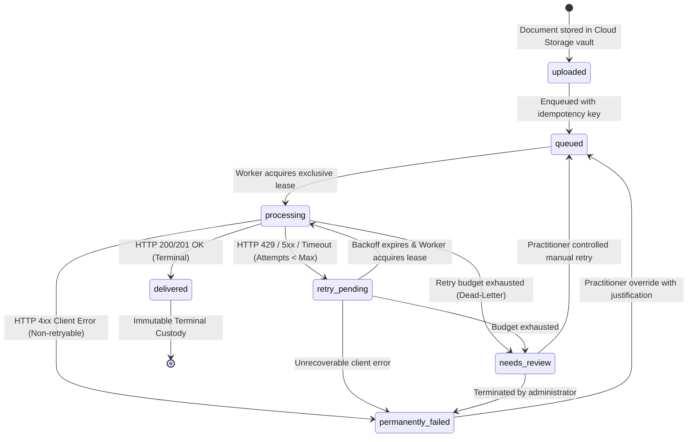
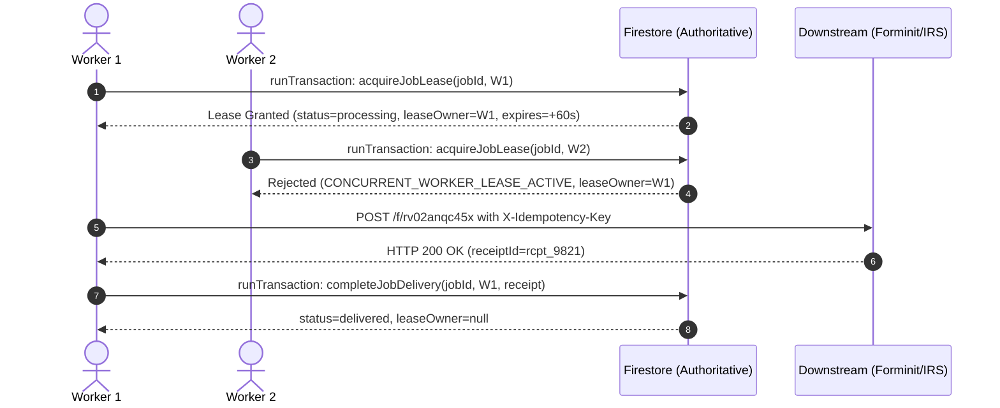

# Durable Document Delivery Queue Architecture Specification
**The File Room by Pivot Aide Tax**  
**Compliance Standards**: IRS Circular 230 § 10.22, Internal Revenue Code (IRC) § 6061, IRC § 7216, FTC Safeguards Rule 16 CFR § 314.4, and NIST SP 800-63-3.

---

## 1. Executive Architecture Summary

The File Room implements a **durable, transactional, and fault-tolerant document delivery queue** for tax return attachments and taxpayer filings. Downstream endpoints (such as Forminit, state tax authorities, and IRS MeF gateways) frequently experience transient HTTP 429 rate limits, maintenance outages, and intermittent 5xx gateway errors.

To guarantee regulatory due diligence under Circular 230 § 10.22 and FTC Safeguards § 314.4:
1. **Firestore is the Authoritative Store**: The Firestore collection `document_delivery_queue` is the single source of truth for queue status, retry budgets, lease locks, and delivery receipts.
2. **Cloud Storage Vault Custody First**: Taxpayer documents are validated (magic bytes, 25MB ceiling, SHA-256 checksum) and permanently encrypted in Google Cloud Storage (`clients/{uid}/...`). A stable storage reference is persisted in Firestore *before* downstream transmission is enqueued.
3. **Bounded Retries with Full Jitter**: Automatic exponential backoff with full jitter and HTTP 429 `Retry-After` parsing guarantees endpoints are not overwhelmed during throttling incidents.
4. **Dead-Letter Escalation (`needs_review`)**: Jobs exhausting their retry budget are routed to the Dead-Letter Queue for practitioner manual review; unrecoverable client errors (HTTP 400, 401, 403, 413, 415, 422) transition immediately to `permanently_failed` without burning retry budgets.
5. **Worker Mutual Exclusion**: Exclusive time-bounded leases granted via atomic Firestore transactions prevent concurrent processing by multiple worker instances. Stale leases from crashed instances are safely reclaimed by queue supervisors.
6. **Strict Idempotency**: Stable, deterministic idempotency keys derived from `clientId`, `documentId`, and file checksum prevent duplicate document records, duplicate logical submissions, or replay storms.
7. **Ephemeral Client Recovery**: `localStorage` and `sessionStorage` serve **only as temporary crash-recovery aids** in the browser. They are unencrypted and non-authoritative; the system **never claims zero data loss** solely because `localStorage` is enabled.

---

## 2. Explicit 7-State Finite State Machine



### State Definitions & Semantics

| State | Semantic Meaning | Mutability | Retry Behavior |
| :--- | :--- | :--- | :--- |
| **`uploaded`** | Document encrypted via AES-256 in Cloud Storage vault; reference persisted in Firestore ledger. | Authoritative | Awaiting queue ingestion. |
| **`queued`** | In authoritative delivery queue; eligible for worker lease acquisition when `nextAttemptAt <= now`. | Dynamic | Eligible for immediate dispatch. |
| **`processing`** | Worker has acquired exclusive time-bounded lease lock via atomic Firestore transaction. | Locked | Exclusive lease owner actively streaming to downstream. |
| **`delivered`** | Downstream HTTP 200/201 OK receipt verified; receipt ID and timestamp persisted. | **Immutable Terminal** | Cannot be retried or re-executed. |
| **`retry_pending`** | Transient failure (HTTP 429, 5xx, or network timeout); backoff timer with full jitter is active. | Dynamic | Waiting for `nextAttemptAt` timestamp. |
| **`permanently_failed`** | Non-retryable error (HTTP 400, 401, 403, 413, 415, 422, or bad payload). | Actionable | Will not retry automatically; requires practitioner override. |
| **`needs_review`** | **Dead-Letter Queue**. Retry budget exhausted. High-priority compliance alert recorded in `audit_logs`. | Suspended | Requires Circular 230 § 10.22 controlled manual recovery. |

---

## 3. Mandatory Metadata Schema

Every document in `document_delivery_queue` captures the following authoritative fields:

```typescript
interface DocumentDeliveryJob {
  // 1. Mandatory Identity & Deduplication
  jobId: string;                   // Deterministic ID: idemp_{clientId}_{docId}_{checksum16}
  idempotencyKey: string;          // Sent via X-Idempotency-Key and fi-text-idempotencyKey
  documentId: string;              // Authoritative ID in /documents or /documentRequests
  requestId: string | null;        // Firm document request correlation ID
  clientId: string;                // Authenticated taxpayer UID
  taxpayerUid: string;             // RBAC ownership anchor
  taxYear: number;                 // e.g. 2026

  // 2. Storage Reference & Custody (Requirement 7)
  fileName: string;                // e.g. "Form_W2_Whitfield.pdf"
  storagePath: string;             // e.g. "clients/{uid}/tax-years/2026/documents/doc.pdf"
  fileStorageUri: string;          // e.g. "gs://uk-client-d90d5.appspot.com/..."
  sha256Checksum: string | null;   // SHA-256 cryptographic digest
  storageReferenceRetained: true;  // Stable storage reference preserved after delivery
  retentionPolicy: string;         // "IRC § 6061 3-Year Statutory Custody & FTC Safeguards § 314.4"

  // 3. Authoritative State Machine & Bounded Retries (Requirements 1 & 2)
  status: 'uploaded' | 'queued' | 'processing' | 'delivered' | 'retry_pending' | 'permanently_failed' | 'needs_review';
  attemptCount: number;            // Current 1-based attempt counter
  maxAttempts: number;             // Default 5; bounded retry budget
  nextAttemptAt: string | null;    // ISO timestamp when job becomes eligible for lease
  lastErrorCategory: string | null;// RATE_LIMITED_429 | SERVER_ERROR_5XX | NETWORK_TIMEOUT | NON_RETRYABLE_CLIENT_ERROR | RETRY_BUDGET_EXHAUSTED
  lastErrorMessage: string | null; // Sanitized downstream error snippet (max 300 chars)
  lastErrorStatusCode: number|null;// HTTP status code

  // 4. Worker Mutual Exclusion Lease (Requirement 5)
  leaseOwner: string | null;       // Unique worker ID: worker_{host}_{pid}_{timestamp}
  leaseExpiresAt: string | null;   // ISO timestamp when worker lease lock expires (default 60s)

  // 5. Delivery Confirmation & Timestamps
  deliveredAt: string | null;      // ISO timestamp of terminal delivery
  deliveryReceipt: object | null;  // Downstream payload: { status, receiptId, response }
  createdAt: string;               // ISO creation timestamp
  updatedAt: string;               // ISO last-modified timestamp

  // 6. Audit Trail & Manual Recovery History (Requirements 8 & 10)
  history: Array<{
    timestamp: string;
    status: string;
    action: string;
    workerId?: string;
    attemptNumber?: number;
    statusCode?: number;
    errorCategory?: string;
    staffUid?: string;
    justification?: string;
  }>;
  manualRetryMetadata?: {
    retriedBy: string;             // Staff UID
    staffEmail: string;            // Practitioner email
    retriedAt: string;             // Timestamp
    justification: string;         // Circular 230 § 10.22 compliance rationale
  };
}
```

---

## 4. Retry Policy & Backoff with Jitter

### Exponential Backoff with Full Jitter Algorithm
To avoid synchronized thundering herd spikes when downstream services recover, The File Room uses the AWS Architecture **Full Jitter** model:

$$\text{backoffSeconds} = \text{rand}(1, \min(\text{maxBackoff}, \text{baseBackoff} \times 2^{\text{attempt} - 1}))$$

Where:
- $\text{baseBackoff} = 5\text{ seconds}$
- $\text{maxBackoff} = 300\text{ seconds}$ (5-minute ceiling)
- $\text{attempt} \in [1, \text{maxAttempts}]$

### HTTP 429 `Retry-After` Handling
When a downstream endpoint responds with HTTP 429 (Too Many Requests), the worker parses the `Retry-After` header:
- **Integer Seconds**: `Retry-After: 120` $\rightarrow$ Wait 120 seconds.
- **HTTP-Date (RFC 7231)**: `Retry-After: Wed, 21 Oct 2026 07:28:00 GMT` $\rightarrow$ Calculated as $\max(0, \text{targetDate} - \text{now})$.
- **Lower Bound**: The effective delay is bounded below by the downstream requested `Retry-After`:
  $$\text{effectiveDelay} = \min(2 \times \text{maxBackoff}, \max(\text{retryAfter}, \text{jitteredBackoff}))$$

### HTTP Error Classification

| HTTP Status | Category | Retryable? | Action |
| :--- | :--- | :--- | :--- |
| **200 / 201** | `SUCCESS` | No | Transition to `delivered`. Persist receipt. |
| **429** | `RATE_LIMITED_429` | **Yes** | Parse `Retry-After`. Compute jittered backoff. Transition to `retry_pending`. |
| **408 / Timeout** | `NETWORK_TIMEOUT` | **Yes** | Compute jittered backoff. Transition to `retry_pending`. |
| **500, 502, 503, 504** | `SERVER_ERROR_5XX` | **Yes** | Compute exponential backoff + jitter. Transition to `retry_pending`. |
| **400, 401, 403, 413, 415, 422** | `NON_RETRYABLE_CLIENT_ERROR` | **No** | Transition immediately to `permanently_failed`. Do not burn retry attempts. |
| **Budget Exhausted** | `RETRY_BUDGET_EXHAUSTED` | **No (Automatic)** | When `attemptCount >= maxAttempts`, transition to `needs_review` (Dead-Letter). |

---

## 5. Worker Concurrency & Mutual Exclusion



### Worker Crash & Restart Resilience
If a worker crashes or drops off the network while processing a job:
1. The lease duration is bounded (default: 60,000 ms).
2. The `scheduledDeliveryQueueSweep` Cloud Function (running every 1 minute) executes `reclaimStaleLeases(db)`:
   - Queries `status == 'processing'` where `leaseExpiresAt <= now`.
   - Transitions stale jobs to `retry_pending` with `nextAttemptAt = now` and error category `LEASE_EXPIRED`.
   - A surviving or restarted worker immediately leases and dispatches the job.
3. The downstream destination is protected from duplicate side effects because the initial `idempotencyKey` is transmitted on every attempt.

---

## 6. Retention Behavior & Statutory Custody

Under **IRC § 6061** (Electronic Signature and Filing Regulations) and **FTC Safeguards Rule 16 CFR § 314.4**:
- **Authoritative Custody**: The taxpayer's primary document is permanently retained in Google Cloud Storage with server-side AES-256 encryption.
- **Stable Reference Retention (Requirement 7)**: The storage reference `storagePath` and `fileStorageUri` remain attached to the document delivery record even after downstream delivery is confirmed. Confirmation of downstream delivery updates delivery state but **never deletes** the authoritative vault copy.
- **Retention Period**: 3 full tax years following filing (statutory standard). Automated deletion is restricted to authorized retention lifecycle policies executed by firm administrators.

---

## 7. Client Recovery Aid vs. Authoritative Storage

> [!WARNING]
> **Statutory Disclaimer**:
> `localStorage` and `sessionStorage` in the taxpayer's browser are **temporary client-side crash-recovery aids only**. They:
> - Are unencrypted and accessible to browser scripts.
> - Can be purged by browser privacy settings, cache clearing, or OS storage pressure.
> - Are **NEVER** treated as encrypted storage or the authoritative copy of a taxpayer document.
> - **Never claim zero data loss solely because `localStorage` is enabled.**
>
> The authoritative record of document custody exists strictly within Google Cloud Storage and the Cloud Firestore ledger.

### Client-Side Dual Messaging (Requirement 9)

The client portal (`client/documents.html`) strictly separates upload success from downstream delivery success:

1. **Storage Vault Custody (Step 1)**:
   - Evaluated upon Cloud Storage write and Firestore metadata ledger commit.
   - User Feedback: `✓ Storage Vault Custody Confirmed (AES-256)`.
2. **Downstream Delivery (Step 2)**:
   - Tracks the progression through `queued` $\rightarrow$ `processing` $\rightarrow$ `delivered` (or `retry_pending` / `needs_review`).
   - User Feedback:
     - `⏳ Queued for Downstream Delivery`: Acknowledged into delivery queue.
     - `⚡ Transmitting downstream...`: In flight with active worker lease.
     - `✓ Downstream Delivery Confirmed`: Verified downstream receipt recorded.
     - `↻ Delivery Retrying (Attempt X/5)`: Temporary delay; scheduled with backoff.
     - `⚠ Under CPA Review`: Flagged for practitioner diligence.

---

## 8. Controlled Manual Recovery (Circular 230 § 10.22)

When a job exhausts all bounded retries and enters `needs_review`, automated retries halt to prevent downstream abuse. Recovery requires an authorized practitioner:

1. **Staff Authorization Check**: Caller must possess `firm_admin`, `firm_preparer`, or `firm_staff` role claims with verified Multi-Factor Authentication (MFA).
2. **Mandatory Compliance Justification**: Practitioner must record a substantive rationale (e.g., *"Forminit endpoint restored and confirmed via health check; verified under Circular 230 § 10.22"*).
3. **Budget Expansion**: Controlled manual retry grants $+3$ additional attempts (or custom practitioner-specified budget).
4. **State Transition**: Transitions job from `needs_review` or `permanently_failed` back to `queued` with `nextAttemptAt = now`.
5. **Immutable Audit Ledger**: An immutable audit record is committed to `/audit_logs` capturing `staffUid`, `staffEmail`, `jobId`, timestamp, and the justification.

---

## 9. Monitoring & Operational Dashboards

### Firm Operations Console (`dashboard.html` & `documents.html`)
The firm console provides real-time oversight of the delivery queue:

- **Metrics Banner**: Real-time counts across all 7 states (`queued`, `processing`, `delivered`, `retry_pending`, `needs_review`, `permanently_failed`, `total`).
- **State Filtering**: 1-click filters for *All*, *Pending & In-Flight*, *↻ Retrying*, *✓ Delivered*, *⚠ Needs Review*, and *✕ Failed*.
- **Search & Telemetry**: Search by Client Name, Document Name, Job ID, or Idempotency Key.
- **Inspect Modal**: Full audit trail of all attempts, worker lease owners, HTTP status codes, and error categories.
- **Sweep Trigger**: `⚡ Sweep Queue` button invokes `processDeliveryQueue` callable Cloud Function.
- **Manual Retry Modal**: Controlled practitioner retry with required justification input.

---

## 10. Deployment & Cloud Infrastructure Requirements

### Firebase Cloud Functions (Node.js 20 / 2nd Gen)

```javascript
// 1. Client & Staff Enqueue Gateway
exports.enqueueDocumentDelivery = onCall({ region: "us-central1", cors: true }, ...);

// 2. Single Job Dispatch Worker
exports.processSingleDeliveryJob = onCall({ region: "us-central1", cors: true }, ...);

// 3. Practitioner Manual Recovery Gateway
exports.retryDeliveryJob = onCall({ region: "us-central1", cors: true }, ...);

// 4. Firm Operations Queue & Metrics Query
exports.getDeliveryQueue = onCall({ region: "us-central1", cors: true }, ...);

// 5. Scheduled Supervisor Sweep (Every 1 minute)
exports.scheduledDeliveryQueueSweep = onSchedule({
  schedule: "every 1 minutes",
  timeZone: "America/New_York",
  region: "us-central1",
  maxInstances: 1
}, ...);

// 6. Cloud Tasks Bounded Queue Handler
exports.processDeliveryTask = onTaskDispatched({
  retryConfig: { maxAttempts: 5, minBackoffSeconds: 5, maxBackoffSeconds: 300 },
  rateLimits: { maxConcurrentDispatches: 5 },
  region: "us-central1"
}, ...);
```

### Firestore Security Rules (`firestore.rules.prod`)
```javascript
match /document_delivery_queue/{jobId} {
  // Clients read own jobs; staff read all
  allow read: if isFirmStaff() || (
    isAuthenticated() && (
      resource.data.clientId == request.auth.uid ||
      resource.data.taxpayerUid == request.auth.uid
    )
  );
  // Clients create own jobs with initial status 'queued' and required storagePath
  allow create: if isFirmStaff() || (
    isAuthenticated() &&
    (request.resource.data.clientId == request.auth.uid || request.resource.data.taxpayerUid == request.auth.uid) &&
    (request.resource.data.status in ['queued', 'uploaded']) &&
    request.resource.data.storagePath != null
  );
  // Only staff can update via client SDK; clients cannot modify worker leases or retry budgets
  allow update: if isFirmStaff();
  // WORM custody: Zero client deletions
  allow delete: if false;
}
```

---

## 11. Primary & Secondary Delivery Destinations & Outcome Reconciliation

### Delivery Endpoints Architecture
1. **Primary Destination (Tier 1 Direct Delivery)**:
   - **URL**: `https://forminit.com/f/rv02anqc45x`
   - **Protocol**: Multipart form transmission with stable idempotency headers (`X-Idempotency-Key` and `fi-text-idempotencyKey`).
   - **Bounded Timeout**: 8,000ms bounded `AbortController` timeout prevents indefinite worker blocking.
   - **Terminal Success**: `downstreamDelivery: 'forminit_delivered'`, `intakeTier: 'Tier 1 (Direct Forminit)'`.

2. **Secondary Fallback Destination (Tier 2 Cloud Function Failover)**:
   - **URL**: `https://us-central1-uk-client-d90d5.cloudfunctions.net/intakeDocumentFallback`
   - **Implementation**: Deployed Firebase Cloud Function `intakeDocumentFallback` (`us-central1`), routed via `firebase.json` rewrite `/intakeDocumentFallback`.
   - **Payload**: JSON document reference containing `storagePath`, `idempotencyKey`, `submissionId`, `clientId`, `sha256Checksum`, and `irc7216ConsentId`.
   - **Security**: Authenticated via Firebase ID Token (`Authorization: Bearer <token>`); validates tenant boundaries against authenticated UID.
   - **Terminal Success**: `downstreamDelivery: 'fallback_delivered'`, `intakeTier: 'Tier 2 (Automatic Fallback - Cloud Function)'`.

### 4-Dimension Status Model
| Dimension | Field | Permitted Values | Architectural Role |
| :--- | :--- | :--- | :--- |
| **Storage State** | `storageState` | `stored`, `pending`, `failed`, `buffered_offline` | Proof of physical custody in encrypted Cloud Storage (`clients/{uid}/...`). Never modified on downstream delivery failure. |
| **Intake Registration** | `registrationState` | `registered`, `pending`, `unconfirmed_offline` | Durable server-side ledger entry in `/document_submissions/{idempotencyKey}` with stable document ID. |
| **Downstream Delivery** | `downstreamDelivery` | `forminit_delivered`, `fallback_delivered`, `queued`, `processing`, `retry_pending`, `needs_review`, `permanently_failed` | Authoritative transmission outcome tracking primary Forminit vs secondary fallback. |
| **Intake Tier** | `intakeTier` | `Tier 1 (Direct Forminit)`, `Tier 2 (Automatic Fallback - Cloud Function)`, `Vault Only` | Visual and audit indicator of which transmission channel accepted custody. |

### Outcome Reconciliation Before Retrying Uncertain Submissions
When a network timeout occurs (`AbortError` or HTTP 408), the downstream gateway may have processed the payload even though the response was lost in transit:
1. Before re-dispatching, `executeDeliveryJob` inspects `/document_submissions/{job.idempotencyKey}` and `/documents/{job.documentId}`.
2. If confirmed delivery already exists (`forminit_delivered` or `fallback_delivered`), the worker completes the job immediately as reconciled without emitting duplicate HTTP requests or re-submitting files.
3. If unconfirmed, the worker safely routes to the secondary Firebase Cloud Function fallback using the exact same stable idempotency key.

### Test Coverage Matrix (`tests/hardened-document-delivery.test.js`)
- [x] **Scenario 1**: Forminit Primary Success (HTTP 200/201, `forminit_delivered`, Tier 1)
- [x] **Scenario 2**: Forminit Timeout (Bounded timeout -> Automatic Fallback success, `fallback_delivered`, Tier 2)
- [x] **Scenario 3**: Forminit HTTP 429 Rate Limiting (Retry-After header parsing & backoff calculation)
- [x] **Scenario 4**: Forminit HTTP 500 Server Error (Automatic routing to Firebase Cloud Function fallback)
- [x] **Scenario 5**: Fallback Success & Intake Registration (Durable intake record with stable ID and idempotency key)
- [x] **Scenario 6**: Both Destinations Failing (Storage vault custody retained, backoff / dead-letter escalation, zero raw PII in audit)
- [x] **Scenario 7**: Duplicate Requests & Uncertain Timeout Reconciliation (Zero duplicate logical submissions)
- [x] **Scenario 8**: Recovery After Browser Closes (Ephemeral recovery aid without treating localStorage as authoritative)
- [x] **Scenario 9**: Manual Retry Authorization Enforcement (Only authorized staff with Circular 230 justification permitted)

