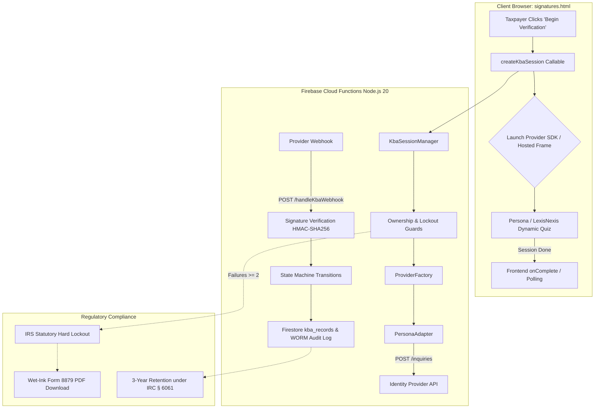

# ENTERPRISE IDENTITY VERIFICATION INTEGRATION
**Platform**: The File Room (`uk-client-d90d5`)  
**Regulatory Standards**: IRS Publication 1345 § 5.2.2, NIST SP 800-63-3 AAL2, IRC § 6061

---

## 1. Overview & Architecture

This document describes the adapter-based enterprise identity verification architecture for The File Room, replacing simulated client-side quizzes with a provider-neutral gateway conforming to **IRS Publication 1345 § 5.2.2**.



---

## 2. Normalized Status Allowlist & State Machine

Verification records strictly adhere to the following normalized allowlist (`functions/kba/types.js`):

| Normalized Status | Description | Permitted Next States |
| :--- | :--- | :--- |
| `pending` | Session initialized; awaiting taxpayer challenge launch. | `in_progress`, `expired` |
| `in_progress` | Dynamic quiz presented to taxpayer; 2-minute timer active. | `verified`, `failed`, `expired`, `manual_review` |
| `verified` | Taxpayer passed dynamic quiz (≥80% score). Unlocks Form 8879 canvas signature pad. | **Terminal** (Immutable WORM) |
| `failed` | Taxpayer failed to meet the 80% passing threshold. If attempt count reaches 2, statutory lockout is enforced. | **Terminal** for this session |
| `expired` | Taxpayer failed to answer questions within the 2-minute statutory window. | **Terminal** for this session |
| `manual_review` | Provider flagged identity vector for manual CPA or provider review. | `verified`, `failed`, `expired` |

### Statutory Limits (IRS Pub 1345 § 5.2.2)
- **Question Count**: 3 to 5 dynamic questions sourced from public and credit bureau records.
- **Passing Threshold**: Minimum 80% correct.
- **Session Duration**: Strict 120-second (2-minute) statutory window.
- **Maximum Consecutive Failures**: 2 attempts maximum per taxpayer per tax return. On the 2nd consecutive failure, electronic signing is permanently revoked, and physical wet-ink Form 8879 execution is enforced.

---

## 3. Modular File Inventory

| File Path | Description |
| :--- | :--- |
| `functions/kba/types.js` | Enums for `KbaStatus`, `StatutoryLimits`, and state transition validator `isValidTransition()`. |
| `functions/kba/provider-interface.js` | Abstract vendor-neutral base class `IdentityVerificationProvider` defining `createSession`, `getSessionStatus`, `verifyWebhookSignature`, and `parseWebhookEvent`. |
| `functions/kba/adapters/persona-adapter.js` | Production adapter for Persona Inquiries API (v2023-01-05). Pre-fills demographic tokens, generates session tokens, verifies HMAC-SHA256 signatures, and maps statuses. |
| `functions/kba/adapters/mock-adapter.js` | Isolated test adapter for automated testing suites and local emulator development (`KBA_PROVIDER=mock`). Never active in production routes. |
| `functions/kba/adapters/lexisnexis-adapter.js` | Specification & contract validator for LexisNexis InstantID Q&A (requires OrgId, FlowId, and mTLS client certs). |
| `functions/kba/adapters/experian-adapter.js` | Specification & contract validator for Experian Precise ID / KnowledgeIQ (CrossCore OAuth 2.0). |
| `functions/kba/provider-factory.js` | Factory instantiating the appropriate adapter based on `process.env.KBA_PROVIDER` and Secret Manager credentials. |
| `functions/kba/session-manager.js` | Enforces Firebase Auth context, engagement ownership, 30s rate limits, 2-attempt statutory lockout, and minimal Firestore persistence (zero SSNs, questions, or answers). |
| `functions/index.js` | Exports Cloud Functions: `createKbaSession` (Callable), `getKbaSessionStatus` (Callable), `handleKbaWebhook` (HTTPS), and `intakeDocumentFallback` (HTTPS). |
| `js/client/signatures.js` | Frontend controller: eliminates mock simulation buttons, embeds hosted provider overlay with a 120s countdown timer, and locks the Form 8879 canvas pad until verification is confirmed. |
| `firestore.rules.prod` | Security rules for `kba_records` and `document_submissions`, enforcing that clients cannot spoof verification status. |

---

## 4. Cloud Functions Specifications

### 1. `createKbaSession` (HTTPS Callable)
* **Auth**: Authenticated taxpayer (`request.auth.uid`).
* **Input**:
  ```json
  {
    "engagementId": "eng_whitfield_4417_2026",
    "signerRole": "primary",
    "returnUrl": "https://thefileroom.tax/client/signatures.html"
  }
  ```
* **Security Checks**:
  1. Validates `request.auth.uid`.
  2. Verifies ownership of `engagements/{engagementId}`.
  3. Checks `kba_records/{engagementId}` for `attemptsCount >= 2` or `kba_locked === true`.
  4. Enforces 30-second cooldown rate limit.
  5. Slices demographic tokens from `users/{uid}` (legal name, DOB, address).
* **Output Returned to Client**:
  ```json
  {
    "success": true,
    "providerSessionId": "inq_9Kx...",
    "sessionToken": "tok_...",
    "clientLaunchUrl": "https://withpersona.com/verify?inquiry-id=inq_9Kx...",
    "expiresAt": "2026-10-14T20:30:00.000Z",
    "maxDurationSeconds": 120,
    "attemptNumber": 1,
    "attemptsRemaining": 1,
    "signerRole": "primary"
  }
  ```
  *(Never returns full SSNs, questions, or provider API keys)*

### 2. `getKbaSessionStatus` (HTTPS Callable)
* **Auth**: Authenticated taxpayer or firm staff.
* **Input**: `{ "engagementId": "...", "signerRole": "primary" }`
* **Output**: `{ "status": "verified|failed|locked_out", "attemptsCount": 1, "kba_locked": false, "auditToken": "inq_..." }`

### 3. `handleKbaWebhook` (HTTPS Endpoint)
* **URL**: `https://us-central1-uk-client-d90d5.cloudfunctions.net/handleKbaWebhook`
* **Security**: Validates `Persona-Signature` header using HMAC-SHA256 with `KBA_WEBHOOK_SECRET` stored in Google Cloud Secret Manager.
* **Processing**:
  1. Verifies timing-safe cryptographic signature.
  2. Maps provider status to normalized allowlist.
  3. Evaluates state transition via `isValidTransition()`.
  4. If failed and attempt count ≥ 2, marks `kba_locked: true` and logs statutory reason.
  5. If passed, updates `kba_records` with `auditToken` and unlocks canvas pad.
  6. Writes 3-year immutable WORM audit custody entry to `audit_logs` under IRC § 6061.

---

## 5. Google Cloud Secret Manager & Environment Variables

| Variable / Secret | Secret Manager / Env | Description | Example |
| :--- | :--- | :--- | :--- |
| `KBA_API_KEY` | Secret Manager (`defineSecret`) | Provider API Key | `persona_live_...` |
| `KBA_WEBHOOK_SECRET` | Secret Manager (`defineSecret`) | Webhook Signing Secret | `whsec_...` |
| `KBA_PROVIDER` | Environment Variable | Active adapter identifier | `persona` (default) or `mock` (test) |
| `KBA_TEMPLATE_ID` | Environment Variable | Persona Inquiry Template ID | `itmpl_irs_pub1345_kba_prod` |
| `KBA_PROVIDER_URL` | Environment Variable | Provider Base URL | `https://withpersona.com/api/v1` |

---

## 6. Deployment Protocol

### Step 1: Install Firebase CLI & Authenticate
```bash
npm install -g firebase-tools
firebase login
firebase use uk-client-d90d5
```

### Step 2: Provision Secrets in Google Cloud Secret Manager
```bash
firebase functions:secrets:set KBA_API_KEY
# Enter your Persona / Provider API Key when prompted

firebase functions:secrets:set KBA_WEBHOOK_SECRET
# Enter your Webhook HMAC Signing Secret when prompted
```

### Step 3: Deploy Security Rules & Cloud Functions
```bash
# 1. Deploy production Firestore and Cloud Storage rules
firebase deploy --only firestore:rules,storage

# 2. Deploy Cloud Functions
firebase deploy --only functions
```

### Step 4: Configure Webhook in Identity Provider Dashboard
1. Log in to Persona Dashboard -> **Webhooks**.
2. Add Webhook Endpoint:
   `https://us-central1-uk-client-d90d5.cloudfunctions.net/handleKbaWebhook`
3. Select Events: `inquiry.completed`, `inquiry.failed`, `inquiry.expired`.
4. Copy Signing Secret into Secret Manager if not already set.
